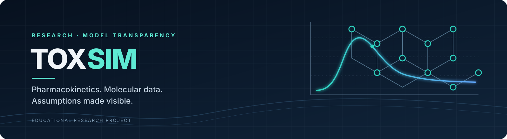

<p align="center">
  
</p>

<p align="center">
  <a href="https://github.com/Aristocrat-prime/Toxsim/actions/workflows/checks.yml"></a>
  
  
  
</p>

<h1 align="center">Toxsim</h1>

<p align="center">
  <strong>Explore the model. Inspect the assumptions. Keep the evidence visible.</strong><br>
  An educational research project for pharmacokinetics, molecular information, and responsible model analysis.
</p>

---

## About the project

Toxsim is being organised as a transparent, reviewable codebase for learning about pharmacokinetic concepts, molecular data, scientific assumptions, and the limits of simplified models. The project emphasises traceable data, explicit units, reproducible checks, and honest communication of uncertainty.

> [!IMPORTANT]
> **Research and safety notice:** Toxsim is not a medical device or clinical decision-support system. Do not use it to choose doses, plan poisoning, select or combine toxic substances, interpret a real exposure, or make treatment decisions. Model outputs are not validated predictions of injury or death. For a suspected exposure, contact local emergency services or a poison information service immediately.

## Project status

**This GitHub repository is a tested documentation and repository-maintenance scaffold, not a runnable release of the original desktop application.** The desktop UI, complete application modules, and full database module from the supplied archive are not integrated here. Installing dependencies alone will not launch the original app.

| Area | Current status |
| --- | --- |
| Project documentation, contribution guidance, and release checklist | Available |
| Python packaging metadata | Present; does not mean the desktop app is packaged |
| Continuous integration | Python 3.11 and 3.12 repository checks pass on the latest verified main commit |
| JSON cache and SMILES repair mapping | Present; syntax/basic-shape checks do not verify chemical identity or scientific accuracy |
| Desktop interface and application entry point | Not integrated |
| Full database and original simulation engine | Not integrated as a runnable application |
| Functional, toxicological, and scientific validation | Not complete |
| Release licence and asset-rights review | Owner decision and review still required |

The supplied archive was audited, but the original dose-to-lethality simulation was not wired into the public repository. This keeps the current repository status explicit rather than presenting a successful scaffolding test as proof that the desktop product works. See the [final handoff and release gates](docs/release-handoff.md) and [implementation status](docs/implementation-status.md).

## What the project covers

<table>
  <tr>
    <td width="33%" valign="top">
      <strong>01 · PK concepts</strong><br>
      Learn the language of absorption, distribution, metabolism, excretion, and concentration over time.
    </td>
    <td width="33%" valign="top">
      <strong>02 · Molecular data</strong><br>
      Treat chemical identifiers and structure strings as data that need provenance and validation.
    </td>
    <td width="33%" valign="top">
      <strong>03 · Model transparency</strong><br>
      Make assumptions, units, uncertainty, and validation gaps visible to readers and reviewers.
    </td>
  </tr>
</table>

## Documentation

| Guide | What you'll find |
| --- | --- |
| [Pharmacokinetics overview](docs/pharmacokinetics.md) | Core ADME concepts and concentration-time terminology |
| [Model scope and limitations](docs/model-scope.md) | Intended use, assumptions, uncertainty, and interpretation cautions |
| [Data policy](docs/data-policy.md) | Provenance, JSON records, identifiers, and SMILES repair records |
| [Installation guide](docs/installation.md) | Environment setup and current launch limitations |
| [Development guide](docs/development.md) | Local quality checks and contributor workflow |
| [Implementation status](docs/implementation-status.md) | Known code-review concerns and milestones |
| [Final handoff and release gates](docs/release-handoff.md) | What's complete, what's not, and what remains before a real release |
| [Glossary](docs/glossary.md) | Key terms used throughout the project |
| [References](docs/references.md) | Further reading and source material |
| [Contribution guide](CONTRIBUTING.md) | How to make useful, reviewable contributions |
| [Tests](tests/README.md) | Current automated-check scope and future test coverage |

## Getting started

### Requirements

- Python 3.11 or 3.12
- Git, if you plan to clone the repository
- The dependencies listed in `requirements.txt`
- RDKit for molecular-structure features; installation differs by platform

### Create a local environment

Clone the repository and create a virtual environment:

```bash
git clone https://github.com/Aristocrat-prime/Toxsim.git
cd Toxsim
python -m venv .venv
```

Activate it:

**Windows PowerShell**
```powershell
.\.venv\Scripts\Activate.ps1
```

**Windows Command Prompt**
```bat
.venv\Scripts\activate.bat
```

**macOS / Linux**
```bash
source .venv/bin/activate
```

Install the baseline dependencies:

```bash
python -m pip install --upgrade pip
python -m pip install -r requirements.txt
```

Run the repository checks:

```bash
python scripts/check_repository.py
python scripts/check_data_files.py
python -m pytest -q
```

> [!NOTE]
> The commands above prepare the environment and validate the repository scaffold; they do not launch the original desktop application. There is no confirmed app launch command for this checkout because its complete UI and application modules are not integrated. See the [installation and troubleshooting guide](docs/installation.md).

## Scientific integrity

- **Keep provenance attached.** Record where a value came from, when it was retrieved, its units, and whether it is measured, estimated, assumed, synthetic, or missing.
- **Do not disguise uncertainty.** A plausible-looking default is not a substitute for evidence.
- **Separate structure from outcome.** A compound identifier or SMILES string does not establish human pharmacokinetics, mixture compatibility, toxicity, or clinical outcome.
- **Validate before making claims.** Software tests check that code behaves as specified; they do not establish that a model predicts real-world biology accurately.

## Contributing

Contributions that improve documentation, data provenance, reproducibility, accessibility, or scientific clarity are welcome. Start with [CONTRIBUTING.md](CONTRIBUTING.md) and make sure new scientific claims are supported by appropriate sources.

## Disclaimer

This project is provided for educational and research discussion only, without warranty of accuracy or fitness for a particular purpose. It does not provide medical advice and must not be used to guide real-world exposure or treatment decisions.
